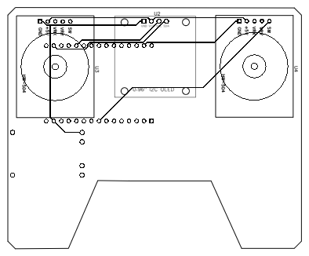

# Control ESP32 para Pysimverse

Este proyecto describe el montaje y el firmware de un control físico basado en una ESP32. El control lee dos joysticks y dos interruptores, muestra los canales en una pantalla OLED y puede trabajar en dos modos:

1. **Control por USB/serial:** la ESP32 envía los seis canales al programa Python que controla el dron en Pysimverse.
2. **Transmisión ESP-NOW:** una versión alternativa del firmware transmite los canales por radio a un receptor ESP-NOW compatible. Este modo requiere un receptor configurado para recibir el protocolo usado por `EspNowRcLink`.

> **Importante:** el firmware USB y el firmware ESP-NOW son alternativas. Selecciona y compila solo uno a la vez. Antes de probar el control en el simulador, revisa la nota sobre el orden de los canales más abajo.

## Contenido

- [Materiales](#materiales)
- [Conexiones](#conexiones)
- [Cómo funciona el control](#cómo-funciona-el-control)
- [Firmware y archivos del proyecto](#firmware-y-archivos-del-proyecto)
- [Compilar y cargar el firmware](#compilar-y-cargar-el-firmware)
- [Conectar el control con Pysimverse](#conectar-el-control-con-pysimverse)
- [Esquemático y diseño de la PCB](#esquemático-y-diseño-de-la-pcb)

## Materiales

- Una placa ESP32 DevKit compatible con el entorno `esp32dev` de PlatformIO.
- Dos módulos de joystick analógico.
- Dos interruptores o pulsadores auxiliares.
- Una pantalla OLED SSD1306 I2C de 0,96 pulgadas.
- Una protoboard y cables para las primeras pruebas.
- Un cable USB de datos para conectar la ESP32 al computador.

Para fabricar una versión permanente del mando también se puede usar la PCB de referencia incluida en este directorio.

## Conexiones

Conecta las señales de los joysticks y los interruptores a los GPIO indicados. Los dos joysticks y la pantalla deben compartir GND con la ESP32.

| Componente | Señal | GPIO de la ESP32 | Uso |
|---|---|---:|---|
| Joystick izquierdo | X | 34 | Throttle (acelerador) |
| Joystick izquierdo | Y | 35 | Yaw (guiñada) |
| Joystick izquierdo | SW | 25 | Interruptor auxiliar 1 |
| Joystick derecho | X | 33 | Eje X del joystick derecho |
| Joystick derecho | Y | 32 | Eje Y del joystick derecho |
| Joystick derecho | SW | 26 | Interruptor auxiliar 2 |
| OLED SSD1306 | SDA | 21 | Datos I2C |
| OLED SSD1306 | SCL | 22 | Reloj I2C |

Para ambos joysticks, conecta **VCC a 3.3 V** y **GND a GND**. En la pantalla OLED, conecta **VCC a 3.3 V**, **GND a GND**, **SDA a GPIO 21** y **SCL a GPIO 22**. Los interruptores están configurados como `INPUT_PULLUP`, por lo que un extremo se conecta al GPIO asignado y el otro a GND.

> No alimentes las entradas GPIO de la ESP32 con 5 V. Comprueba el pinout de tu módulo antes de cablearlo: la tabla corresponde a los GPIO usados por el firmware de este proyecto.

## Cómo funciona el control

En el modo USB/serial, el recorrido de los datos es:

1. La ESP32 toma lecturas analógicas de los dos joysticks y lee el estado de los interruptores.
2. El firmware suaviza las lecturas de los ejes con un filtro EMA, aplica una zona muerta a los ejes centrados y convierte las señales a canales RC entre **1000 y 2000**.
3. Cada 20 ms (50 veces por segundo) envía una línea por el puerto serial a **115200 baudios**, con este formato:

   ```text
   RC: 1500 1500 1000 1500 1000 1000
   ```

4. El controlador Python lee el último paquete válido, adapta los canales al rango de control de Pysimverse y aplica las condiciones de armado y seguridad.

Los interruptores cambian entre 1000 y 2000 al accionarlos. La pantalla OLED muestra los valores actuales para facilitar la comprobación del montaje.

### Atención al orden de los canales

El controlador Python interpreta los seis valores en este orden:

| Posición en la línea `RC:` | Interpretación en Python |
|---:|---|
| 1 | Roll |
| 2 | Pitch |
| 3 | Throttle |
| 4 | Yaw |
| 5 | Armado (interruptor 1) |
| 6 | Auxiliar (interruptor 2) |

En las versiones actuales de `tx_usb.cpp` y `tx.txt`, el primer canal se calcula a partir del eje **Pitch** del joystick derecho y el segundo a partir del eje **Roll**. Esto no coincide con el orden que espera `templates/esp32_controller.py` para los dos primeros canales. Verifica o corrige esa correspondencia antes de usar el mando; de lo contrario, roll y pitch pueden quedar intercambiados.

## Firmware y archivos del proyecto

El proyecto de PlatformIO se encuentra en `Platformio/`.

- [`Platformio/platformio.ini`](Platformio/platformio.ini): selecciona la placa `esp32dev`, el framework Arduino, la velocidad de monitor serial y las bibliotecas declaradas. Incluye las dependencias de la OLED y de ESP-NOW; la variante USB no usa directamente la biblioteca `EspNowRcLink`.
- [`Platformio/src/tx_usb.cpp`](Platformio/src/tx_usb.cpp): firmware para el modo USB/serial. Lee los joysticks, procesa los canales, muestra sus valores en la OLED y escribe las líneas `RC:` que consume el controlador Python.
- [`Platformio/src/tx.txt`](Platformio/src/tx.txt): versión alternativa con transmisión mediante `EspNowRcLink`. También imprime los canales por serial para diagnóstico. Al tener extensión `.txt`, PlatformIO no la compila como fuente C++; debe activarse como se explica en la sección de compilación si se quiere probar este modo.

El código Python asociado al control y las herramientas de cámara están en el directorio raíz del repositorio, fuera de `Control-pysimverse/`:

- [`../templates/esp32_controller.py`](../templates/esp32_controller.py): recibe las líneas RC por serial, convierte los ejes al rango de Pysimverse, exige throttle bajo más el interruptor 1 para armar y deja de enviar movimiento si se pierde la señal durante el tiempo de seguridad configurado. Al salir, envía comandos neutrales, ordena aterrizar y libera el puerto serial.
- [`../misiones/camara/mission2imagecapturecontrol.py`](../misiones/camara/mission2imagecapturecontrol.py): misión separada para controlar el dron con el teclado mientras muestra el video y permite guardar capturas JPG con la tecla `Z`. **Este script no lee el control ESP32**; sus controles son `W/S`, `A/D`, flechas, `Q/E` y `Z`.

## Compilar y cargar el firmware

Instala PlatformIO y conecta la ESP32 por USB. Desde la raíz del repositorio, compila y carga el firmware USB con:

```powershell
pio run -d Control-pysimverse/Platformio -e esp32dev
pio run -d Control-pysimverse/Platformio -e esp32dev -t upload --upload-port COM3
pio device monitor -d Control-pysimverse/Platformio -b 115200 --port COM3
```

Sustituye `COM3` por el puerto asignado a la ESP32 en tu equipo. El monitor permite comprobar las líneas `RC:` que emite el firmware.

Para compilar la variante ESP-NOW, activa **solo una** fuente C++ en `Platformio/src/`: conserva `tx.txt` como copia de referencia, cambia temporalmente su extensión a `.cpp` y cambia la extensión de `tx_usb.cpp` a `.txt`. Después compila y carga con los comandos anteriores. Para regresar al modo USB, restaura las extensiones originales. No dejes ambas variantes con extensión `.cpp` al mismo tiempo, porque definen sus propias funciones `setup()` y `loop()`.

## Conectar el control con Pysimverse

1. Carga el firmware USB en la ESP32.
2. Identifica el puerto COM correcto en tu computador.
3. En `templates/esp32_controller.py`, cambia `SERIAL_PORT = "COM3"` por el puerto que corresponda.
4. Instala en el entorno Python del proyecto las dependencias que utiliza el controlador, incluido PySerial, y asegúrate de que Pysimverse esté disponible.
5. Cierra el monitor serial de PlatformIO y cualquier otra aplicación que esté usando el puerto: normalmente solo un programa puede abrirlo a la vez.
6. Desde la raíz del repositorio, inicia el controlador:

   ```powershell
   python templates/esp32_controller.py
   ```

El armado requiere que el throttle esté por debajo del umbral definido en el script y que el interruptor auxiliar 1 esté activado. Comprueba la asignación de canales y el funcionamiento de los interruptores sin iniciar el vuelo. Si dejan de llegar paquetes válidos, el controlador entra en failsafe y pone los comandos de movimiento en cero.

## Esquemático y diseño de la PCB

El esquemático siguiente representa las conexiones entre la ESP32, los dos módulos de joystick, la pantalla OLED y el conector USB. Úsalo como referencia de cableado y contrasta cada conexión con el pinout de los componentes físicos antes de alimentar el circuito.


La imagen de la PCB muestra la forma de la placa y la ubicación prevista de los componentes para construir el mando. Es una referencia visual del diseño: antes de fabricar, verifica el enrutado, las reglas eléctricas, las dimensiones y la correspondencia de huellas en el proyecto de diseño electrónico.


