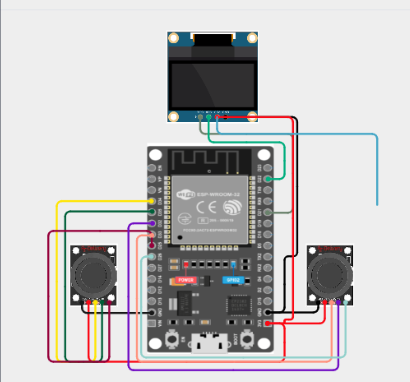
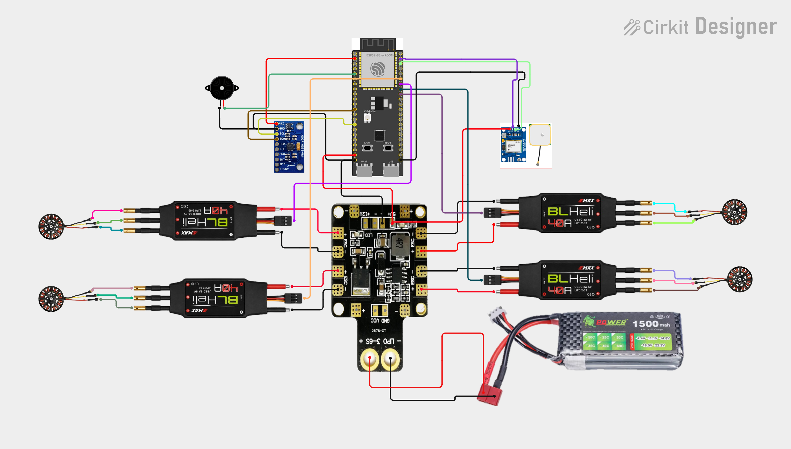

# Pysimverse DroneESP

Proyecto educativo y experimental para aprender control de drones combinando el simulador **Pysimverse**, Python, visión por computadora y un mando físico construido con ESP32 y Finalizando con la construcción de un drone de bajo coste. 

La intención es practicar primero en el simulador y avanzar hacia una experiencia de control físico experimental usando pysimverse para luego proceder con la construccion del drone fisico y probarlo con el mismo control. En el estado actual, el firmware de PlatformIO envía por USB/serial los canales del mando y los programas Python traducen esos datos a comandos para el dron simulado. Cabe resaltar que esto no equivale todavía a controlar directamente un dron físico con motores, es solo una experiencia para aprender de manera dinamica y evitar sobrecostos al aprender a volar el dron directamente.

## Inspiración y proyectos de referencia

El trabajo toma como punto de partida tutoriales y proyectos existentes. Se mencionan como **referencias e inspiración**; los enlaces llevan a los recursos originales:

- [Learn Drone Programming with Python – Tutorial](https://www.youtube.com/watch?v=k-yDYgc8AmU&t=5305s), de [freeCodeCamp.org](https://www.youtube.com/@freecodecamp): referencia para aprender programación de drones con Python y trabajar con Pysimverse.
- [mini-esp-now-rc-drone](https://github.com/nikhiltelase/mini-esp-now-rc-drone/tree/main), de Nikhil Telase: referencia para explorar un transmisor de control RC basado en ESP32 y joysticks.
- [esp-fc](https://github.com/rtlopez/esp-fc), de rtlopez: referencia e inspiración para la exploración de un controlador de vuelo basado en ESP32 y Betaflight.

El proyecto adapta estas ideas a sus objetivos de aprendizaje y experimentación. La comunicación implementada en este repositorio entre el mando y **Pysimverse** es **serial por USB**; no debe confundirse con el enlace ESP-NOW de los proyectos de referencia.

## Qué contiene

| Ruta | Contenido |
| --- | --- |
| `templates/` | Ejemplos reutilizables para vuelos básicos, control por teclado, mando ESP32, transmisión de video y detección con OpenCV o MediaPipe. |
| `misiones/garage/` | Recorridos de vuelo programados para practicar desplazamientos y giros en el simulador. |
| `misiones/control/` | Detección de color y seguimiento de una línea mediante visión artificial; el seguidor utiliza un controlador PID para corregir el rumbo. |
| `misiones/camara/` | Captura y visualización de imágenes del simulador; incluye una misión que combina video, mando serial y captura accionada desde un switch. |
| `misiones/gestos/` | Detección de gestos de mano y su uso como entrada de control. |
| `misiones/body/` | Detección de pose corporal y experimento de conteo de saltos mediante el movimiento vertical de las caderas. |
| `Platformio/` | Proyecto de firmware para ESP32: lectura de joysticks e interruptores, pantalla OLED y envío de canales RC por USB/serial. |
| `models/` | Modelos de MediaPipe para detección de manos y poses. |
| `requirements.txt` | Lista de dependencias Python del proyecto. |

## Referencias de MediaPipe

Los scripts de detección necesitan los modelos `.task` en `models/`:

- [Hand Landmarker](https://storage.googleapis.com/mediapipe-models/hand_landmarker/hand_landmarker/float16/1/hand_landmarker.task): puntos de referencia de la mano para reconocer gestos.
- [Pose Landmarker Lite](https://storage.googleapis.com/mediapipe-models/pose_landmarker/pose_landmarker_lite/float16/latest/pose_landmarker_lite.task): puntos de referencia del cuerpo para analizar poses y movimiento.

## Control físico del mando: ESP32, joysticks y simulador

El flujo de control físico se divide entre el firmware y Python:

1. Los joysticks e interruptores se leen en la ESP32.
2. El firmware filtra y convierte las lecturas a seis canales RC en el rango de **1000 a 2000**.
3. La ESP32 envía una línea por USB/serial a **115200 baudios**, con el formato `RC: canal1 canal2 canal3 canal4 canal5 canal6`.
4. Python lee el puerto serie, convierte los canales de los ejes al rango de control de Pysimverse y envía comandos al dron simulado.

### Firmware PlatformIO

El proyecto de firmware está en `Platformio/`:

- `Platformio/platformio.ini` configura el entorno `esp32dev`, la plataforma Espressif 32, framework Arduino, velocidad serial y bibliotecas de pantalla OLED.
- `Platformio/src/tx_usb.cpp` implementa la lectura y transmisión del mando. Configura la resolución ADC de 12 bits, calibra los centros de los sticks al arrancar, suaviza las lecturas analógicas con un filtro EMA, aplica una zona muerta y envía los seis canales cada 20 ms (50 Hz).
- La pantalla SSD1306 muestra los valores de roll, pitch, throttle, yaw y los dos auxiliares. El firmware inicializa I2C con SDA en GPIO 21 y SCL en GPIO 22.
- Dos interruptores se leen como entradas con `INPUT_PULLUP`; su estado se alterna y se filtra con anti-rebote.

El código identifica la transmisión como `USB RC`: en esta integración el transporte efectivo es el puerto serial USB. Las dependencias ESP-NOW incluidas en la configuración de PlatformIO están relacionadas con la experimentación basada en las referencias externas, pero el flujo descrito aquí usa serial.
siendo de esta manera que el resultante de las conexiones quedaria de la siguiente manera:



### Programas Python que reciben el mando

- `templates/esp32_controller.py` es el controlador general. Lee seis canales, convierte roll, pitch, throttle y yaw al rango usado por `send_rc_control`, y aplica una condición de armado: throttle bajo y switch de armado activado. También contempla la pérdida de paquetes mediante un timeout de seguridad.
- `misiones/camara/mission2imagecapturecontrol.py` combina el mando serial con el video del simulador. Usa un switch auxiliar para accionar la tecla `Z` y guardar una imagen durante la misión en `capturas_drone/`.
- `misiones/controlEsp32/` está creada como carpeta, pero actualmente no contiene scripts; los programas de integración física descritos arriba están en `templates/` y `misiones/camara/`.

En los scripts Python, el puerto se configura inicialmente como `COM3`. Cámbialo al puerto asignado a la ESP32 en el equipo donde se ejecute el proyecto. Cierra el monitor serial de PlatformIO u otra aplicación que tenga abierto ese puerto antes de iniciar el controlador Python: normalmente solo un proceso puede usarlo a la vez.

### Compilar y cargar el firmware

Con PlatformIO instalado y la ESP32 conectada:

```powershell
pio run -d Platformio -e esp32dev
pio run -d Platformio -e esp32dev -t upload --upload-port COM3
pio device monitor -d Platformio -b 115200 --port COM3
```

Sustituye `COM3` por el puerto correcto. El monitor serial sirve para comprobar los mensajes y canales enviados por el firmware; ciérralo antes de ejecutar el controlador Python sobre el mismo puerto.

## Misiones y ejemplos de simulación

### Vuelo y control manual

- `templates/first_flight.py`: ejemplo de conexión, despegue, movimientos verticales y laterales, giro, ajuste de velocidad y aterrizaje.
- `templates/keyboardcontroller.py`: control continuo mediante teclado; combina teclas para generar comandos de roll, pitch, throttle y yaw.
- `templates/rc_controller.py`: ejemplo mínimo de envío repetido de comandos RC al simulador.
- `misiones/garage/`: trayectorias con secuencias de movimientos para practicar navegación en el escenario del garage.

### Cámara y visión por computadora

- `templates/dronevideostream.py` y los ejemplos de cámara muestran el flujo de video del simulador.
- `misiones/camara/mission2imagecapturecontrol.py` combina feed de video, mando físico por serial y guardado de capturas.
- `misiones/control/deteccionColorDrone.py` muestra la detección de un color mediante una máscara.
- `misiones/control/droneseguidordelinea.py` obtiene el centroide de una línea detectada y ajusta el giro con un PID para seguirla.

### Gestos y movimiento corporal

- `misiones/gestos/gesture_hand_mediapie_mission.py` clasifica gestos de mano a partir de los puntos de MediaPipe y los utiliza como entradas para una misión.
- `misiones/body/mision1_body.py` analiza la pose corporal y estima saltos a partir de la velocidad vertical del centro de las caderas.
- En `templates/` hay ejemplos relacionados de detección de manos, poses y saltos que sirven como punto de partida.

Las misiones son ejemplos experimentales que pueden necesitar el simulador, la cámara, los modelos y el entorno configurados antes de ejecutarse. Revisa cada script para conocer sus controles, escenario y condición de salida.

## Preparación del entorno Python

Se recomienda usar un entorno virtual y Python compatible con las versiones instaladas de las dependencias:

```powershell
py -m venv .venv
.\.venv\Scripts\Activate.ps1
python -m pip install --upgrade pip
python -m pip install -r requirements.txt
```

Para ejecutar un script, activa el entorno y lánzalo desde la raíz del repositorio, por ejemplo:

```powershell
python .\templates\first_flight.py
```

Los ejemplos de Pysimverse requieren que el simulador esté disponible y conectado. Los scripts de MediaPipe requieren cámara y modelos; los de control físico requieren también la ESP32, el puerto serial correcto y el firmware cargado.

## Tecnologías

- **Python** y **Pysimverse**: lógica de las misiones y control del dron simulado.
- **OpenCV**, **NumPy** y **cvzone**: captura, visualización y procesamiento de imágenes.
- **MediaPipe**: detección de manos y poses.
- **PySerial**: recepción de canales desde la ESP32.
- **Pynput** y **PyAutoGUI**: entrada de teclado en algunos ejemplos.
- **PlatformIO**, **Arduino/C++** y **ESP32**: firmware del mando físico.
- **SSD1306 / Adafruit GFX**: interfaz OLED del transmisor.

## Construccion del drone esp32 

## Alcance actual

El objetivo es aprender y experimentar con control, visión artificial y una interfaz física, avanzando desde el simulador hacia hardware. El firmware y los programas Python enlazan el mando ESP32 con Pysimverse por USB/serial; la referencia a proyectos de drones físicos orienta el trabajo futuro, pero este repositorio no debe interpretarse como un firmware completo de vuelo ni como una implementación de control de motores de un dron real.

## Video de demostración

En el siguiente video se muestra una demostración breve del dron:

<video src="https://raw.githubusercontent.com/farid3312/Pysimverse-DroneESP/main/espDrone.mp4" controls width="720">
  Tu navegador no puede reproducir el video. [Ábrelo o descárgalo aquí](https://raw.githubusercontent.com/farid3312/Pysimverse-DroneESP/main/espDrone.mp4).
</video>
